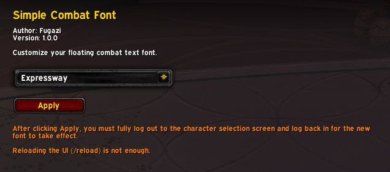

# Simple Combat Font

  
Swaps your floating combat text to the font of your choice.  

This addon does **not** change the _behaviour_ of the floating combat text.  
__It only changes the font. It cannot change the position, scroll direction, etc.__

Currently supports:
- Blizzard default fonts
- LibSharedMedia fonts (fonts registered by other addons such as ElvUI, EQOL, BetterBlizzPlates, etc)
- If you use [Shared Media](https://www.curseforge.com/wow/addons/sharedmedia), those fonts will already be available

## Installation
Extract SimpleCombatFont folder to `Interface\AddOns\` folder

## Usage
1. Use `/scf` or open the Simple Combat Font panel in Game Menu > Options > Addons

2. Select a font from the drop-down list and click **Apply**

3. Log out to character select screen and log back in  

## Note
Your selection will be saved and applied each login (account-wide). You only need to log out and log in when changing the font in the settings panel.

Due to the way WoW handles 3D font changes, you **must** log out to the character select screen, and log back in to apply this font change.

I'm punting on adding a custom font system. I don't want to bog this addon down too much. Most players are already using addons that are registering many custom font options. If you'd like to include a font of your own, please use [SharedMedia](https://www.curseforge.com/wow/addons/sharedmedia) to get your custom font registered. My addon will pick it up.